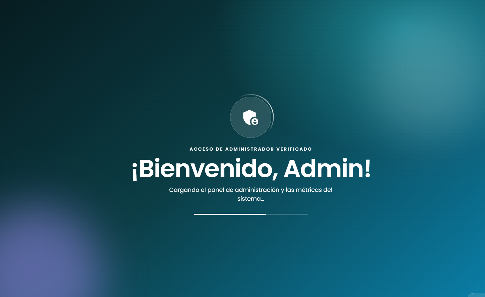
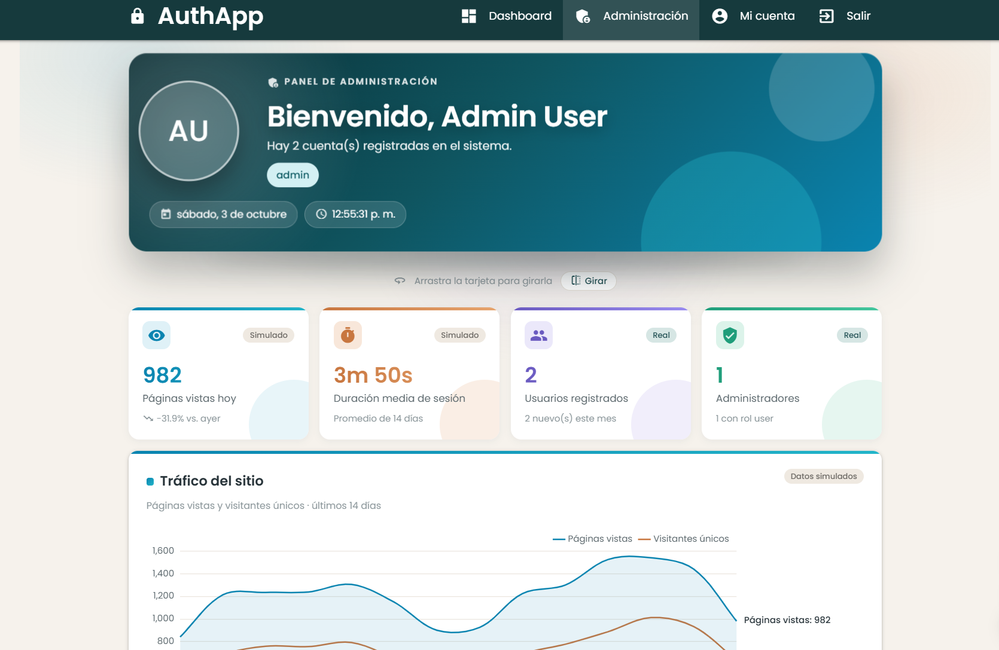

# Express Mongo Auth

Sistema de autenticación y autorización con roles (`admin` y `user`) usando Node.js, Express, MongoDB y JSON Web Tokens. Incluye un frontend dinámico con EJS y Materialize.

## Requisitos

- Node.js 18 o superior
- MongoDB local o MongoDB Atlas
- npm

## Instalación

Desde esta carpeta:

```bash
npm install
```

Copia el archivo de ejemplo y completa tus valores:

```bash
cp .env.example .env
```

Cambia al menos `MONGODB_URI`, `JWT_SECRET` y `ADMIN_PASSWORD`.

No subas el archivo `.env` al repositorio. Contiene información sensible y está excluido por `.gitignore`.

### Usuario administrador inicial

Al iniciar, el servidor crea los roles `user` y `admin` y un usuario administrador si no existen. Por defecto:

| Email | Contraseña |
| --- | --- |
| `admin@example.com` | `Admin123@` |

Se pueden cambiar con variables opcionales en `.env`: `ADMIN_EMAIL`, `ADMIN_PASSWORD`, `ADMIN_NAME`, `ADMIN_LAST_NAME`, `ADMIN_PHONE`, `ADMIN_BIRTHDATE`, `ADMIN_PROFILE_URL` y `ADMIN_ADDRESS`.

## Ejecución

Modo normal:

```bash
npm start
```

Modo desarrollo:

```bash
npm run dev
```

Abre la aplicación en:

```text
http://localhost:3000
```

El puerto puede cambiar si se configura `PORT` en `.env`.

## Funcionalidades

- Página de inicio con dos accesos a pantalla completa: Administrador y Usuario.
- Login y registro en una misma vista, con pestañas animadas y validación de contraseña en vivo.
- El registro público asigna siempre el rol `user`; el administrador se crea con el seed.
- Token JWT guardado en `sessionStorage` y enviado como `Authorization: Bearer <token>`.
- Redirección al dashboard según el rol después de iniciar sesión.
- Mi cuenta: ver y editar los datos propios, con cambio de contraseña opcional.
- Dashboard de usuario: datos personales, progreso del perfil y actividad.
- Dashboard de administrador: métricas, gráficos y listado de usuarios con detalle.
- Bienvenida animada al ingresar y tarjeta 3D con los datos de la sesión, compartidas por ambos dashboards.
- Páginas 403 (acceso denegado) y 404 (no encontrada).
- Diseño responsive.

> Los gráficos de tráfico, vistas por página, dispositivos y actividad usan **datos simulados**, y se indica en cada uno. Los registros por mes y los indicadores de usuarios usan datos reales.

## Capturas

| Inicio | Login y registro |
| --- | --- |
|  |  |

| Bienvenida al ingresar | Dashboard de administrador |
| --- | --- |
|  |  |

## Reglas de contraseña

Mínimo 8 caracteres, con al menos una mayúscula, un dígito y un carácter especial (`# $ % & * @`).

## Rutas de la API

| Método | Ruta | Acceso | Función |
| --- | --- | --- | --- |
| POST | `/api/auth/signUp` | Público | Registrar usuario (rol `user`) |
| POST | `/api/auth/signIn` | Público | Iniciar sesión y obtener el token |
| GET | `/api/users/me` | Autenticado | Datos del usuario actual |
| PUT | `/api/users/me` | Autenticado | Editar los datos propios |
| GET | `/api/users` | Admin | Listar usuarios |
| GET | `/api/users/:id` | Admin | Ver un usuario |
| GET | `/health` | Público | Estado del servidor |

## Rutas de las vistas

| Ruta | Página | Acceso |
| --- | --- | --- |
| `/` | Inicio (elegir Administrador o Usuario) | Público |
| `/signIn` | Iniciar sesión | Público |
| `/signUp` | Registro | Público |
| `/dashboard` | Dashboard de usuario | `user` o `admin` |
| `/admin/dashboard` | Dashboard de administrador | `admin` |
| `/profile` | Mi cuenta | Autenticado |
| `/403` | Acceso denegado | Público |

## Reglas de navegación

- Sin token JWT válido: redirige a `/signIn`.
- Token expirado: cierra la sesión automáticamente y vuelve a `/signIn`.
- Rol insuficiente: redirige a `/403`.
- Ruta inexistente: muestra la página 404.

La protección de las vistas se hace en el navegador. La seguridad real la aplica la API con los middlewares `authenticate` y `authorize`.

## Estructura principal

```text
src/
  controllers/    Lógica de las peticiones
  middlewares/    Autenticación (JWT) y autorización por rol
  models/         Modelos User y Role
  repositories/   Acceso a datos
  routes/         Rutas de la API y de las vistas
  services/       Reglas de negocio
  utils/          Seeds de roles y del administrador
  views/          Plantillas EJS (pages y partials)
  public/         CSS y JavaScript del navegador
  server.js       Configuración de Express y conexión a MongoDB
```

## Tecnologías

Node.js, Express, MongoDB, Mongoose, JSON Web Token, bcrypt, EJS, Materialize y Chart.js.
