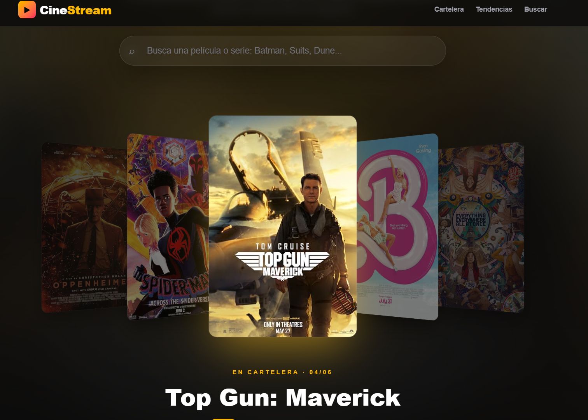
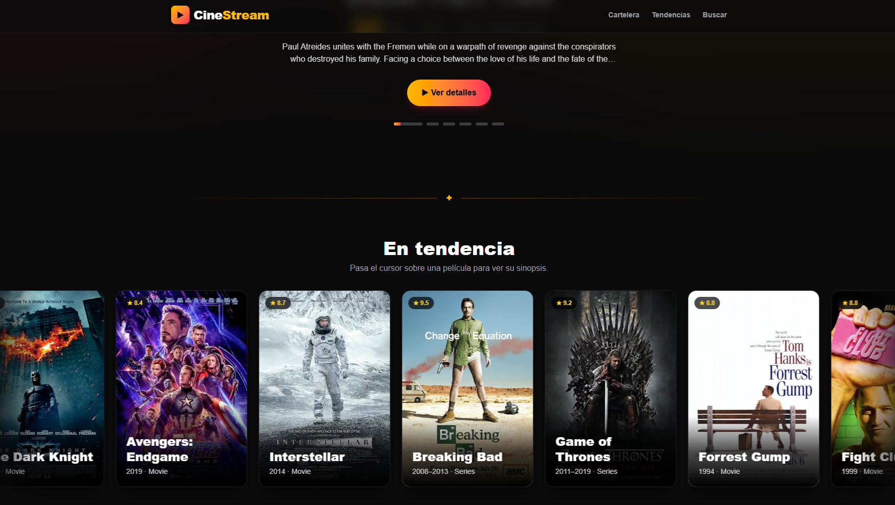

# CineStream — Galería de Películas y Series

Aplicación web de películas y series construida con **Next.js 16 (App Router)**. En la misma aplicación combina **SSR** (renderizado en el servidor) y **CSR** (renderizado en el cliente), con datos de la [OMDb API](https://www.omdbapi.com).

**Sitio en producción:** https://semana09-cinestream-git-main-rony-s-projects10.vercel.app/

| Captura | Descripción |
|---|---|
|  | Portada: búsqueda arriba y cartelera 3D que gira sola |
|  | Sección "En tendencia": cinta de películas en movimiento |

## Stack

- Next.js 16.4.2 (App Router, Turbopack, Cache Components)
- React 19.3 + React Compiler
- TypeScript
- Tailwind CSS v4
- Axios
- OMDb API
- Despliegue en Vercel

## Funcionalidades

- **Telón de entrada:** al abrir la web aparece el logo y se abre un telón de cine.
- **Búsqueda en tiempo real:** los resultados aparecen mientras escribes, sin recargar la página.
- **Cartelera 3D:** carrusel tipo *coverflow* que gira solo, sin flechas. Se pausa al pasar el cursor, se puede deslizar en el celular, y el fondo de la portada cambia con cada película.
- **En tendencia:** cinta de películas que se desplaza de lado a lado.
- **Tarjetas que se voltean:** al pasar el cursor, la tarjeta gira y muestra la sinopsis.
- **Página de detalle** (`/movies/[imdbID]`): sinopsis, ficha técnica y calificaciones de IMDb, Rotten Tomatoes y Metacritic.
- **Animaciones al hacer scroll** y respeto de la opción del sistema "reducir movimiento".

## SSR vs CSR: dónde se usa cada uno y por qué

| Parte | Estrategia | Justificación |
|---|---|---|
| Portada: cartelera y tendencias | **SSR** (Server Component con `async/await` + `'use cache'`) | El contenido es el mismo para todos los usuarios. Llega dentro del HTML: carga rápida, sin spinners y visible para buscadores (SEO). Al estar cacheado, no se consulta OMDb en cada visita (límite de 1000 peticiones al día). |
| Búsqueda | **CSR** (`'use client'`, `useState`, `useEffect`) | Depende de lo que escribe el usuario. Se resuelve en el navegador y actualiza los resultados sin recargar. Espera 400 ms tras la última tecla para no saturar la API. |
| Tarjetas que se voltean | **CSR** | Es pura interacción (hover). Las tarjetas de búsqueda piden la sinopsis la primera vez que se voltean. |
| Cartelera 3D | **SSR + CSR** | Los datos vienen del servidor, pero el giro automático y la pausa necesitan estado en el navegador. |
| Detalle `/movies/[imdbID]` | **SSR** (`<Suspense>` + `'use cache'`) | Cada película tiene una URL propia que se puede compartir y que los buscadores pueden indexar. |
| `/api/omdb` | **Route Handler** (servidor) | Hace de intermediario con OMDb para que la API key nunca llegue al navegador. |

### Criterios de evaluación

| Criterio | Dónde se cumple |
|---|---|
| Uso correcto de `'use client'` | Solo en componentes interactivos: `MovieSearch`, `MovieCard`, `HeroShowcase`, `Reveal`. Las páginas son Server Components. |
| Uso de `async/await` | `app/page.tsx`, `app/movies/[imdbID]/page.tsx`, `lib/omdb.ts`, `app/api/omdb/route.ts` |
| UI con Tailwind CSS | Toda la interfaz. Las animaciones (`keyframes`) están en `app/globals.css`. |
| Hooks `useState` y `useEffect` | `MovieSearch` (búsqueda con espera), `MovieCard`, `HeroShowcase`, `Reveal` |
| Justificación SSR/CSR | Tabla anterior y comentarios en `app/page.tsx` y `app/MovieSearch.tsx` |

## Rutas

| Ruta | Tipo | Descripción |
|---|---|---|
| `/` | Estática (cacheada) | Portada de CineStream |
| `/movies/[imdbID]` | Partial Prerender | Detalle de una película o serie |
| `/api/omdb` | Dinámica | Proxy a OMDb (`?s=`, `?i=`, `?t=`, `?y=`) |
| `/pokemon-csr` | Estática + CSR | Laboratorio: Pokémon aleatorio pedido desde el navegador |
| `/pokemon-ssr` | Partial Prerender | Laboratorio: Pokémon aleatorio generado en el servidor en cada petición |
| `/weather` | Partial Prerender | Laboratorio: clima de Lima (SSR) y de otras ciudades (CSR) en la misma página |

## Estructura del proyecto

```
my-first-project/
├── app/
│   ├── api/omdb/route.ts         # Proxy a OMDb: agrega la API key en el servidor
│   ├── movies/[imdbID]/page.tsx  # Detalle de película o serie
│   ├── pokemon-csr/              # Laboratorio: CSR
│   ├── pokemon-ssr/              # Laboratorio: SSR
│   ├── weather/                  # Laboratorio: SSR + CSR en una misma página
│   ├── layout.tsx                # Layout raíz: telón de entrada, header y footer
│   ├── page.tsx                  # Portada (Server Component)
│   ├── HeroShowcase.tsx          # Cartelera 3D (coverflow)
│   ├── MovieSearch.tsx           # Búsqueda en tiempo real
│   ├── MovieCard.tsx             # Tarjeta que se voltea y muestra la sinopsis
│   ├── MovieMarquee.tsx          # Cinta de tendencias en movimiento
│   ├── IntroCurtain.tsx          # Animación de entrada (telón)
│   ├── Header.tsx / Reveal.tsx / SectionDivider.tsx
│   └── globals.css               # Tailwind + animaciones
├── lib/omdb.ts                   # Tipos, cliente de OMDb y funciones cacheadas
├── docs/                         # Capturas
└── next.config.ts                # cacheComponents, reactCompiler
```

## Variables de entorno

Crear un archivo `.env.local` en la raíz del proyecto. Ya está excluido de git por `.gitignore`.

```
OMDB_API_KEY=tu_api_key
```

La API key gratuita se genera en https://www.omdbapi.com/apikey.aspx

## Instalación y ejecución local

```bash
npm install
npm run dev        # http://localhost:3000
```

Build de producción:

```bash
npm run build
npm start
```

## Despliegue en Vercel

El proyecto vive dentro de un monorepo, así que en Vercel se configuró:

- **Root Directory:** `SEMANA09/my-first-project`
- **Framework:** Next.js (detectado automáticamente)
- **Variable de entorno:** `OMDB_API_KEY`

Cada push a `main` genera un nuevo despliegue automáticamente.

## Laboratorio: observaciones en el Network Tab

| Ruta | ¿Cuándo aparece el contenido? | ¿Cuántas peticiones se ven en el navegador? |
|---|---|---|
| `/pokemon-csr` | Después de cargar la página: primero se ve el spinner | 1 XHR a PokeAPI (2 en desarrollo, por React Strict Mode) |
| `/pokemon-ssr` | Llega ya renderizado desde el servidor | Ninguna a PokeAPI: la petición la hace el servidor |
| `/weather` (Lima) | Llega ya renderizado desde el servidor | Ninguna a Open-Meteo |
| `/weather` (Mundo) | Después de cargar, con spinner | 1 XHR al cargar y 1 más por cada cambio de ciudad |

## Conclusiones

1. **SSR entrega el contenido listo desde el primer momento.** Los datos vienen dentro del HTML: no hay spinners y los buscadores pueden leerlos. A cambio, el servidor hace más trabajo.
2. **CSR ofrece más interactividad, pero el contenido llega después.** Es ideal para lo que depende del usuario, como búsquedas o selectores, porque se actualiza sin recargar la página.
3. **Lo mejor es combinarlas.** Una página puede ser un Server Component e incluir componentes de cliente solo donde hace falta interacción. La pregunta clave es si el dato depende o no de lo que hace el usuario.
4. **En Next.js, lo que define si algo es SSR o CSR es el código, no el nombre.** Los componentes son de servidor por defecto; `'use client'` los pasa al navegador.
5. **El Network Tab de DevTools permite verificar la estrategia usada**: cuándo aparece el contenido, cuántas peticiones se hacen y quién las inicia.

## Enlaces

- Sitio en producción: https://semana09-cinestream-git-main-rony-s-projects10.vercel.app/
- Repositorio: https://github.com/Rony10-az/Desarrollo_Aplicaciones_Avanzado
