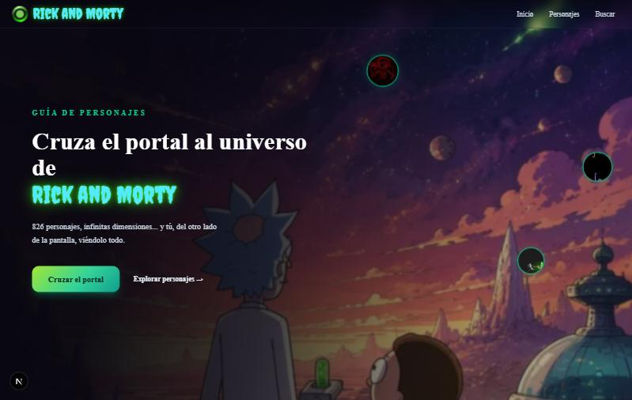
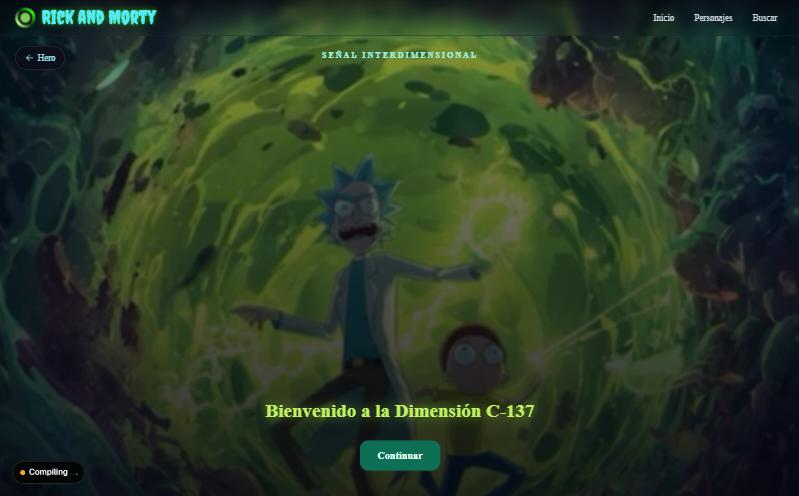
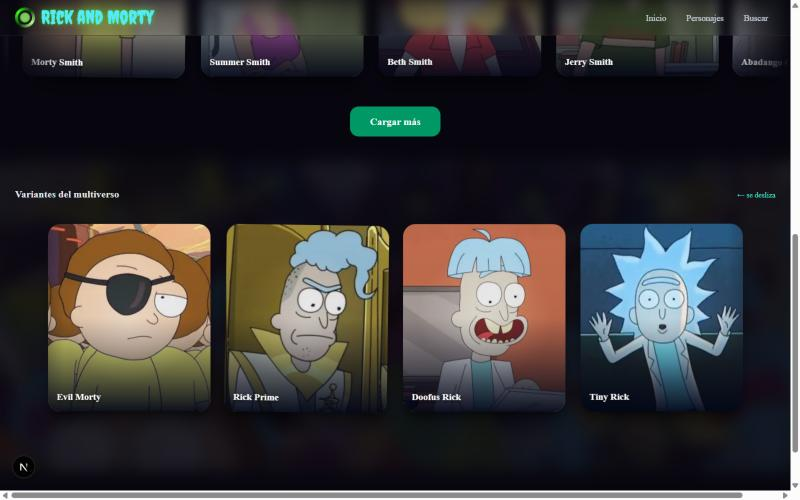
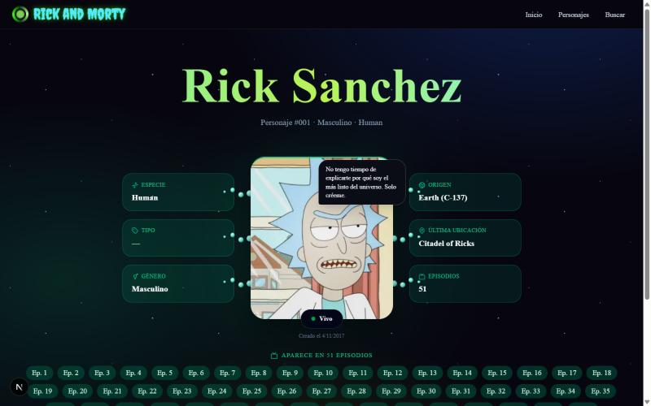

# Rick and Morty — Guía de personajes (+ Pokédex)

Aplicación web construida con **Next.js 16 (App Router)** que combina **SSG**, **ISR** y **CSR** en una misma app. La pieza principal es una guía de los 826 personajes de *Rick and Morty* con una experiencia cinematográfica en cuatro pantallas propias conectadas por clic (Hero → Portal → Lista → Detalle) y fichas con tentáculos en 3D; además incluye una Pokédex como laboratorio de SSG/ISR clásico.

| Captura | Descripción |
|---|---|
|  | **Hero** (`/RickandMorty`): después de la intro (aro, retrato, sello verde) aparece el fondo a página completa con chips flotantes y el botón "Cruzar el portal" |
|  | **Portal** (`/RickandMorty/portal`): se llega con un clic y se reproduce sola una vez; el fondo encadena tres fotos con flash y zoom en cada corte |
|  | **Lista** (`/RickandMorty/lista`): carrusel de "Personajes principales" y, debajo, "Variantes del multiverso" (Evil Morty, Rick Prime, Doofus Rick, Tiny Rick), deslizándose en direcciones opuestas |
|  | **Detalle** (`/RickandMorty/[id]`): globo de diálogo, estado y fecha bajo el retrato, y tentáculos en 3D real (`perspective` + `translateZ`) conectando la imagen con cada ficha |

## Stack

- Next.js 16.4.3 (App Router, Turbopack, Cache Components)
- React 19.3
- TypeScript
- Tailwind CSS v4
- [Motion](https://motion.dev) (sucesor de Framer Motion)
- lucide-react / react-icons
- [The Rick and Morty API](https://rickandmortyapi.com) y [PokéAPI](https://pokeapi.co)

## Funcionalidades

**Rick and Morty**
- **Cuatro pantallas conectadas por clic**, como un mapa de pantallas: Hero → Portal → Lista → Detalle. Cada una es su propia ruta en vez de secciones de una sola página con scroll.
- **Hero con intro cinemática:** al entrar se juega una secuencia de ~5.6 s (aro que se expande, retrato en zoom, "Bienvenido" y el título sellado en verde) antes de mostrar el contenido; respeta "reducir movimiento" del sistema. El navbar es fijo y transparente, así el fondo se ve detrás de él.
- **Cruce del portal:** página propia (`/RickandMorty/portal`) que se reproduce sola una vez (8.6 s): el fondo encadena tres fotos (persecución → caída → túnel) con flash y pulso de zoom en cada corte, y termina con el botón "Continuar".
- **Banner de llegada:** en la lista, la foto del túnel se repite como transición de continuidad, con zoom de entrada.
- **Dos carruseles reales:** "Personajes principales" (se alimenta de la búsqueda/paginación) y "Variantes del multiverso", que trae de la propia API a Evil Morty, Rick Prime, Doofus Rick y Tiny Rick; cada uno avanza solo, en direcciones opuestas, y se puede arrastrar.
- **Búsqueda en tiempo real** por nombre, tipo, estado y género, con debounce de 400 ms.
- **Tarjetas 3D** (`TiltCard`, `perspective` + `preserve-3d`) que se inclinan siguiendo el mouse.
- **Ficha de personaje:** globo de diálogo (varía según si está vivo, muerto o desconocido), estado y fecha de creación bajo el retrato, y seis fichas de datos conectadas a la imagen con tentáculos animados en 3D real.

**Pokédex** (`/pokemon`)
- Lista de los 151 Pokémon originales (SSG) y ficha de detalle por `/pokemon/[name]` (SSG + ISR clásico con `revalidate`).

## SSG, ISR y CSR: dónde se usa cada uno y por qué

| Parte | Estrategia | Justificación |
|---|---|---|
| `/RickandMorty` (Hero) | **SSG** (`getCharacters` con `cache: 'force-cache'`) | Solo necesita el total de personajes para la portada; se guarda en el build y no se vuelve a pedir a la API en cada visita. |
| `/RickandMorty/lista` | **SSG** (misma `getCharacters` + `getVariantCharacters`) | El listado inicial y las variantes son iguales para todos: se guardan en el build. |
| `/RickandMorty/[id]` (826 fichas) | **SSG + ISR** (`generateStaticParams` + `'use cache'` / `cacheLife` a 10 días) | Cada personaje tiene una URL propia, indexable y compartible. Se generan todas en el build consultando la API una sola vez (`/character/1,2,3,...`) para no chocar con el límite de peticiones, y se regeneran solas cada 10 días sin redeploy. |
| Variantes del multiverso | **SSG + ISR** (`getVariantCharacters`, misma `cacheLife`) | Se resuelven en el servidor buscando cada nombre en la API real; se cachean junto con el resto de personajes. |
| Búsqueda y filtros | **CSR** (`'use client'`, `useState`, `useEffect`) | Depende de lo que escribe el usuario; se resuelve en el navegador sin recargar la página. |
| Carruseles, intro del Hero, cruce del portal, tarjetas 3D | **CSR** | Son animación e interacción pura (mouse, arrastre, temporizadores): necesitan estado y el DOM del navegador. |
| `/pokemon` y `/pokemon/[name]` | **SSG + ISR clásico** (`generateStaticParams` + `fetch(..., { next: { revalidate: 86400 } })`) | Mismo objetivo que en Rick and Morty, pero con la API de revalidación "clásica" de Next.js en vez de Cache Components, a modo de comparación. |

## Rutas

| Ruta | Tipo | Descripción |
|---|---|---|
| `/` | Redirección | Envía a `/RickandMorty` |
| `/RickandMorty` | SSG | Hero |
| `/RickandMorty/portal` | Estática | Cruce del portal, se llega con clic desde el Hero |
| `/RickandMorty/lista` | SSG | Lista de personajes con búsqueda y los dos carruseles |
| `/RickandMorty/[id]` | SSG + ISR (826 páginas) | Ficha de un personaje |
| `/pokemon` | SSG | Lista de los 151 Pokémon originales |
| `/pokemon/[name]` | SSG + ISR | Ficha de un Pokémon |

## Estructura del proyecto

```
next-ssg-isr-app/
├── src/app/
│   ├── RickandMorty/
│   │   ├── page.tsx              # Hero (Server Component)
│   │   ├── portal/page.tsx       # Cruce del portal (se reproduce solo)
│   │   ├── lista/page.tsx        # Lista de personajes con búsqueda
│   │   ├── [id]/page.tsx         # Ficha de personaje (SSG + ISR)
│   │   ├── Hero.tsx               # Intro cinemática y fondo a página completa
│   │   ├── PortalTransition.tsx   # Secuencia del cruce del portal (8.6s, autoplay)
│   │   ├── CharacterSearch.tsx    # Búsqueda, filtros y banner de llegada
│   │   ├── CharacterCarousel.tsx  # Carrusel infinito (autoplay + arrastre)
│   │   ├── CharacterCard.tsx      # Tarjeta 3D con bamboleo
│   │   ├── CharacterShowcase.tsx  # Ficha de personaje
│   │   ├── Tentacle.tsx           # Tentáculo en 3D real (perspective + translateZ)
│   │   ├── TiltCard.tsx           # Inclinación 3D siguiendo el mouse
│   │   ├── api.ts                 # Fetch cacheado (SSG/ISR) a la API
│   │   └── search.ts              # Fetch de búsqueda (CSR)
│   ├── pokemon/
│   │   ├── page.tsx               # Lista de Pokémon (SSG)
│   │   └── [name]/page.tsx        # Ficha de Pokémon (SSG + ISR)
│   ├── page.tsx                   # Redirige a /RickandMorty
│   └── globals.css                # Tailwind + animaciones
├── public/rickandmorty/           # Imágenes locales (hero, portal, variantes)
├── docs/                          # Capturas para este README
└── next.config.ts                 # cacheComponents, remotePatterns
```

## Instalación y ejecución local

```bash
npm install
npm run dev        # http://localhost:3000
```

Build de producción:

```bash
npm run build
npm start
```

## Enlaces

- Repositorio: https://github.com/Rony10-az/Desarrollo_Aplicaciones_Avanzado
- [The Rick and Morty API](https://rickandmortyapi.com)
- [PokéAPI](https://pokeapi.co)
